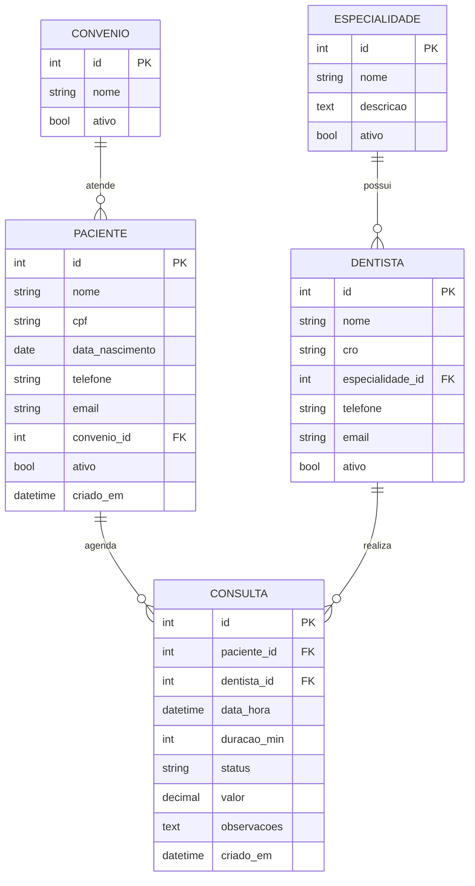

# OdontoClínica

Sistema de gestão para clínicas odontológicas, desenvolvido com Django.

## Integrantes do grupo

| Nome | GitHub |
| --- | --- |
| Lucca Dias Bertolucci | [@luccabertolucci](https://github.com/luccabertolucci) |
| Patrícia Souza Couto | [@bikindev](https://github.com/bikindev) |
| Pedro Otávio | [@potaviocarv](https://github.com/potaviocarv) |

## Descrição do projeto

A OdontoClínica permite o cadastro e a gestão de pacientes, dentistas, especialidades, convênios e consultas. O ambiente administrativo (Django Admin) é personalizado com o tema Jazzmin, templates próprios e filtros.

## Tecnologias utilizadas

- Python 3.12
- Django 6
- SQLite
- django-jazzmin (tema do admin)
- HTML/CSS (Django Templates)

## Instalação

1. Crie e ative um ambiente virtual:

   ```powershell
   py -m venv .venv
   .\.venv\Scripts\Activate.ps1
   pip install -r requirements.txt
   ```

2. Aplique as migrations:

   ```powershell
   python manage.py migrate
   ```

3. Crie o superusuário do admin:

   ```powershell
   python manage.py createsuperuser
   ```

## Execução

```powershell
python manage.py runserver
```

- **Portal da clínica:** http://127.0.0.1:8000/ (após entrar com sua conta)
- **Cadastros:** use os atalhos de Pacientes, Dentistas, Convênios e Especialidades no menu lateral.
- **Administração:** http://127.0.0.1:8000/admin/ (somente para usuários staff)
- Credenciais de demonstração (apenas desenvolvimento): usuário `admin`, senha `admin123`.

Comandos auxiliares:

```powershell
python manage.py seed_demo      # popula dados de demonstração
python manage.py setup_roles    # cria grupos e permissões
```

## Principais funcionalidades

- Autenticação por usuário e senha.
- Cadastro de agendamentos pelo portal da clínica, sem precisar acessar o Django Admin.
- Bloqueio de consultas sobrepostas para o mesmo dentista, tanto no portal/Admin quanto diretamente no SQLite; horários adjacentes e consultas canceladas não bloqueiam novos horários.
- Administração Django disponível somente para usuários staff/superusuários.
- Cadastro de pacientes, dentistas, especialidades e convênios pelo portal, sem precisar acessar o Django Admin.
- Ambiente administrativo com tema claro/escuro (Jazzmin), templates e CSS personalizados.
- Filtros no admin: por status, dentista, data, período (filtro customizado) e busca por nome/CPF.
- Grupos de perfil: Administrador, Dentista e Atendente.
- Dashboard com visões operacional e financeira, gráficos de consultas, status, horários e faturamento.

### Dashboards

A página inicial exige autenticação e reúne dois painéis selecionáveis no topo: **Visão geral** e **Financeiro**. As páginas **Agendamentos**, **Pacientes**, **Dentistas**, **Convênios** e **Especialidades**, acessíveis pelo menu lateral, permitem incluir registros diretamente no portal. A visão geral resume consultas do mês, status, horários mais procurados, pacientes recorrentes e próximo atendimento. O painel financeiro apresenta valores realizados e previstos com base no campo `valor` das consultas, além do ticket médio e das faixas horárias de maior faturamento. Como o sistema ainda não registra pagamentos nem despesas, os valores representam consultas com status **Realizada** ou valores previstos em consultas **Agendadas/Confirmadas**; não representam fluxo de caixa ou lucro. O link para Administração aparece no menu lateral apenas para usuários staff; os demais usuários usam o portal.

### Testes de integração

Com o ambiente virtual ativado e as dependências instaladas, execute os testes de cadastro do dashboard com:

```powershell
python manage.py test agenda.test_dashboard_integration
```

Os cenários cadastram pacientes e consultas pelo formulário real do Django Admin e verificam os indicadores operacionais e financeiros retornados pelo dashboard.

## Estrutura do projeto

```
odontoclinica/   configurações do projeto (settings, urls)
clinica/         Paciente, Dentista, Especialidade, Convênio
agenda/          Consulta, filtros e dados de demonstração
templates/       templates do admin
static/          arquivos estáticos (CSS, logo)
```

## Modelagem do banco de dados



## Branches

- `main` — versão estável
- `develop` — integração do desenvolvimento
- `feature/*` — desenvolvimento de funcionalidades
