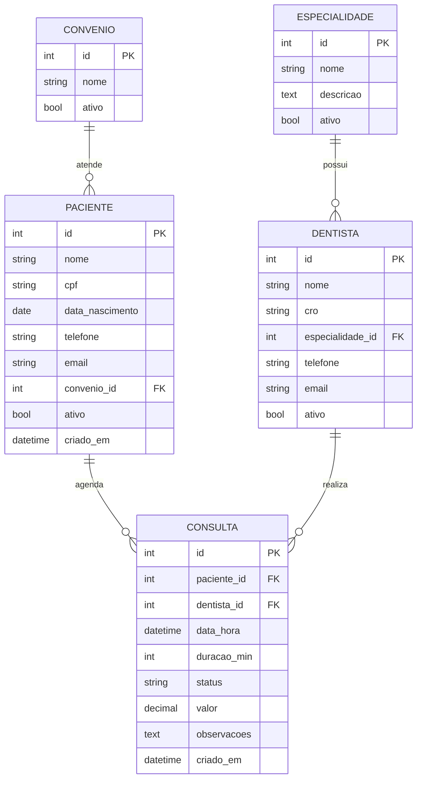

# OdontoClínica

Sistema de gestão para clínicas odontológicas, desenvolvido com Django.

## Integrantes do grupo

| Nome | GitHub |
| --- | --- |
| Lucca Dias Bertolucci | [@luccabertolucci](https://github.com/luccabertolucci) |
| Patrícia Souza Couto | [@bikindev](https://github.com/bikindev) |
| Pedro Otávio | [@potaviocarv](https://github.com/potaviocarv) |

## Descrição do projeto

A OdontoClínica permite o cadastro e a gestão de pacientes, dentistas, especialidades, convênios e consultas. O ambiente administrativo (Django Admin) é personalizado com o tema Jazzmin, templates próprios e filtros.

## Tecnologias utilizadas

- Python 3.12
- Django 6
- SQLite
- django-jazzmin (tema do admin)
- HTML/CSS (Django Templates)

## Instalação

1. Crie e ative um ambiente virtual:

   ```powershell
   py -m venv .venv
   .\.venv\Scripts\Activate.ps1
   pip install -r requirements.txt
   ```

2. Aplique as migrations:

   ```powershell
   python manage.py migrate
   ```

3. Crie o superusuário do admin:

   ```powershell
   python manage.py createsuperuser
   ```

## Execução

```powershell
python manage.py runserver
```

- **Ambiente administrativo:** http://127.0.0.1:8000/admin/
- Credenciais de demonstração (apenas desenvolvimento): usuário `admin`, senha `admin123`.

Comandos auxiliares:

```powershell
python manage.py seed_demo      # popula dados de demonstração
python manage.py setup_roles    # cria grupos e permissões
```

## Principais funcionalidades

- Autenticação por usuário e senha.
- CRUD completo de **Consultas** no ambiente administrativo.
- Cadastro de pacientes, dentistas, especialidades e convênios.
- Ambiente administrativo com tema claro/escuro (Jazzmin), templates e CSS personalizados.
- Filtros no admin: por status, dentista, data, período (filtro customizado) e busca por nome/CPF.
- Grupos de perfil: Administrador, Dentista e Atendente.

## Estrutura do projeto

```
odontoclinica/   configurações do projeto (settings, urls)
clinica/         Paciente, Dentista, Especialidade, Convênio
agenda/          Consulta, filtros e dados de demonstração
templates/       templates do admin
static/          arquivos estáticos (CSS, logo)
```

## Modelagem do banco de dados



## Branches

- `main` — versão estável
- `develop` — integração do desenvolvimento
- `feature/*` — desenvolvimento de funcionalidades
